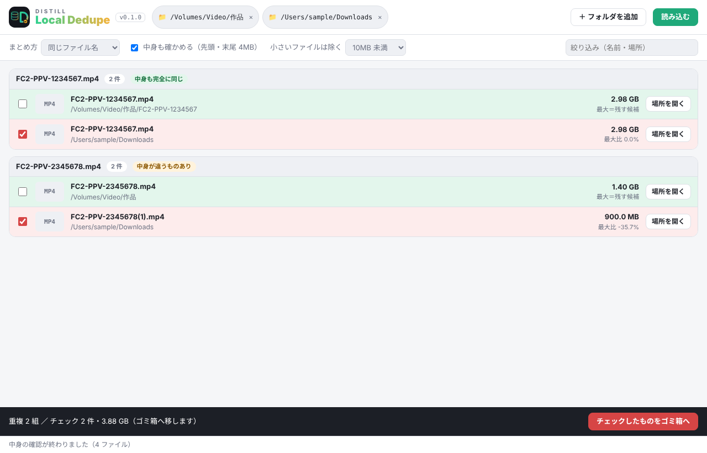

<p align="center">
  
</p>

<h1 align="center">Distill Local Dedupe</h1>

<p align="center">
  パソコンのフォルダ（Finder・エクスプローラー）の重複ファイルを見比べて整理するアプリ<br>
  Mac・Windows・Linux ／ <sub>by Noel Labs</sub>
</p>

[PikPak Distill – Dedupe](https://github.com/Noel-Labs39/pikpak-distill) のローカル版です。同じルール・同じ画面の考え方で、パソコンの中のフォルダや外付けディスクを整理します。



## できること（0.1）

| 機能 | 内容 |
| --- | --- |
| 読み込む | 選んだフォルダ（複数・外付けディスク・ネットワークのフォルダも可）の中を読みます。**読むだけで、ファイルは何も変更しません** |
| 重複をまとめる | 「同じファイル名」（大文字小文字・`(1)` は同じとみなす）または「同じ品番（作品）」でまとめます。各組で一番大きいファイルを残す候補にし、それ以外にチェックを入れます |
| 中身も確かめる | 先頭と末尾 4MB のハッシュを比べ、「中身も完全に同じ」かを表示します（大きな動画でもすぐ終わります） |
| ゴミ箱へ | チェックしたものを OS のゴミ箱（ごみ箱）へ移します。**完全には削除しません**。元に戻すときはゴミ箱から |
| 場所を開く | Finder・エクスプローラーでそのファイルの場所を開きます |

今後：ファイル名を整える・作品ごとに仕分け・販売者ごとに仕分け（PikPak 版の調査結果を共有）・サムネイルとコマ一覧・移動の「元に戻す」

## インストール

[最新のリリース](https://github.com/Noel-Labs39/distill-local-dedupe/releases/latest) から、お使いの OS のものをダウンロードします。Apple・Microsoft の署名を受けていないため、初回だけ OS の確認が出ます。

| OS | ファイル | 初回だけ |
| --- | --- | --- |
| Mac | `.dmg` | 開いて「Distill Local Dedupe」をアプリケーションへ。開けないときは「システム設定」→「プライバシーとセキュリティ」→「このまま開く」 |
| Windows | `.msi` または `-setup.exe` | 「Windows によって PC が保護されました」と出たら「詳細情報」→「実行」 |
| Linux | `.AppImage`（または `.deb`） | `chmod +x` してから実行 |

## 開発

```
npm install
npm run dev     # 開発用に起動
npm run build   # 配布用に組み立て
```

Rust と、各 OS の [Tauri の準備](https://v2.tauri.app/start/prerequisites/) が必要です。`src-tauri/tauri.conf.json` の `version` を上げて main に入れると、GitHub Actions が 3 つの OS 向けを組み立てて、その版のリリース（例：`v0.1.0`）を作って添付します。

## ライセンス

MIT
